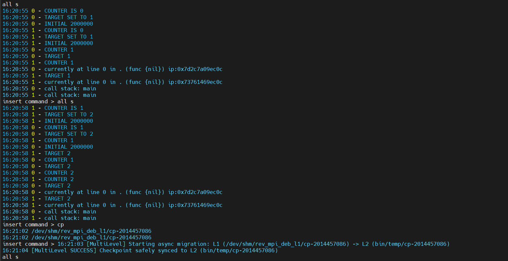

# Tool Demonstration & Empirical Evaluation

To comprehensively illustrate the practical benefits, operational efficiency, and low-latency characteristics of our
architectural enhancements, we demonstrate **RevDebug-MPI** using `examples/circle.c`.

`circle.c` is a standard MPI benchmark application in which distributed processes pass messages in a continuous circular
ring topology. This specific benchmark was similarly employed in our foundational work to validate baseline
reverse-stepping capabilities, making it an ideal candidate to showcase our newly achieved performance optimizations: *
*Multi-Level Checkpointing** and **Incremental Checkpointing**.

---

## 1. Launching the Demonstration Session

First, we compile `circle.c` using the instrumentation wrapper and launch the orchestrator across 2 MPI ranks with the
`criu` backend enabled:

```bash
# Compile the benchmark with DWARF-4 instrumentation
bin/compiler examples/circle.c

# Launch RevDebug-MPI with 2 MPI processes using CRIU
sudo env PATH=$PATH bin/orchestrator 2 ./bin/targets/circle criu
```

As the developer interactively steps through the distributed code to trace a potential message-passing anomaly, the
debugger periodically triggers global state captures to establish restoration points for backwards execution. In a
traditional monolithic setup, these captures cause severe UI freezing. RevDebug-MPI entirely circumvents this
bottleneck.

---

## 2. Interactive State Inspection & Execution Flow

**Figure 1** displays the debugger's command-line interface during a live debugging session of `circle.c`. The developer
begins by issuing the `all s` command, which instructs the orchestrator to execute a single atomic step across all
active MPI ranks simultaneously.



*Figure 1: RevDebug-MPI terminal interface displaying interactive rank state inspection (`all s`) and asynchronous
L1-to-L2 checkpoint migration (`cp`) in the background without blocking the session.*

As shown in the console output of **Figure 1**, RevDebug-MPI intercepts the execution flow and extracts the internal
state of each distributed process:

* **Local Variable Inspection:** Rank `0` and Rank `1` report their local variables in real time (e.g., `COUNTER IS 0`,
  `TARGET SET TO 1`, `INITIAL 2000000`, followed by `COUNTER 1`, `TARGET 2` on subsequent steps).
* **Instruction Pointers & Call Stacks:** Each rank reports its exact instruction pointer (e.g., `ip:0x7d2c7a09ec0c` and
  `ip:0x73761469ec0c`) and active call stack (`call stack: main`).

This fine-grained, step-by-step visibility across concurrent ranks is essential for diagnosing race conditions and
message anomalies.

---

## 3. Multi-Level Checkpointing in Action

Realizing the need to establish a restoration point before advancing further into a potentially erroneous state, the
developer manually issues a checkpoint request using the `cp` command (visible near the bottom of **Figure 1**).

1. **Instantaneous Tier 1 Capture (`L1`):** Immediately upon executing `cp` at `16:21:02`, the orchestrator broadcasts
   the dump signal to all node debuggers. As seen in **Figure 1**, the snapshot for both ranks is captured and saved
   directly to the Level 1 RAM-disk at `/dev/shm/rev_mpi_deb_l1/cp-2014457086`. Because Tier 1 operates entirely in
   volatile memory (`tmpfs`), I/O latency is negligible. The execution pause lasts only a fraction of a millisecond, and
   the developer is instantly returned to the interactive prompt (`insert command >`), free to immediately issue the
   next `all s` command.
2. **Asynchronous Tier 2 Migration (`L2`):** Simultaneously, as highlighted in the bottom lines of **Figure 1**, the
   orchestrator seamlessly initiates the background migration process at `16:21:03` (
   `[MultiLevel] Starting async migration: L1 -> L2`) without blocking the CLI or Web GUI. Within one second (
   `16:21:04`), the dedicated background daemon completes the I/O-intensive task of copying the serialized checkpoint
   images from volatile RAM to persistent disk storage (`bin/temp/cp-2014457086`), emitting a `[MultiLevel SUCCESS]`
   confirmation while the main debugging thread remains 100% responsive.

---

## 4. Incremental Checkpointing Efficiency

While Multi-Level Checkpointing solves the immediate I/O latency problem, the integration of CRIU's **Incremental
Checkpointing** ensures long-term storage scalability across extended debugging sessions. To empirically evaluate the
storage efficiency gained by this mechanism, we inspect the physical disk usage of the snapshots residing in the Level 1
RAM-disk using the `du -sk` command, as illustrated in **Figure 2**.


*Figure 2: System output (`du -sk`) demonstrating the disk usage (in KB) of the baseline full checkpoint versus the
subsequent incremental snapshot in the Level 1 RAM-disk.*

### Detailed Breakdown of Results in Figure 2:

* **Baseline Full Checkpoint (`cp-1317672396`):** The first directory shown in **Figure 2** represents the initial, full
  baseline state capture of the MPI application. Because it must record the complete memory footprint—including all
  shared MPI libraries, heap allocations, and execution stacks—it consumes **16,400 KB (~16.4 MB)** of memory.
* **Subsequent Incremental Checkpoint (`cp-3623492737`):** The second directory in **Figure 2** is generated after the
  developer performs an execution step. Because RevDebug-MPI tracks page modifications at the OS kernel level via
  `soft-dirty` bits, this snapshot bypasses unmodified code segments and static buffers, recording only the specific
  memory pages dirtied during that single step. Consequently, as shown in **Figure 2**, it consumes merely **5,092 KB (~
  5.09 MB)**.

---

## 5. Cumulative Impact on HPC Debugging Scalability

As demonstrated in **Figure 2**, the reduction from **16.4 MB to 5.09 MB** represents an immediate **69% decrease in
snapshot payload size**.

While saving ~11.3 MB on a single step in a 2-rank benchmark is already substantial, the compounding effect in
real-world HPC workflows is critical:

1. **Preserving Volatile RAM-Disk Quotas:** Since `/dev/shm` shares physical system memory with the running MPI ranks,
   reducing snapshot size by 69% allows the Level 1 ring buffer to store over 3x as many immediate restoration points
   within the same memory budget.
2. **Accelerating L1-to-L2 Background Migration:** Smaller snapshot payloads translate directly into faster asynchronous
   transfers from RAM to persistent disk (or NFS), preventing background I/O queues from saturating during rapid
   interactive stepping.